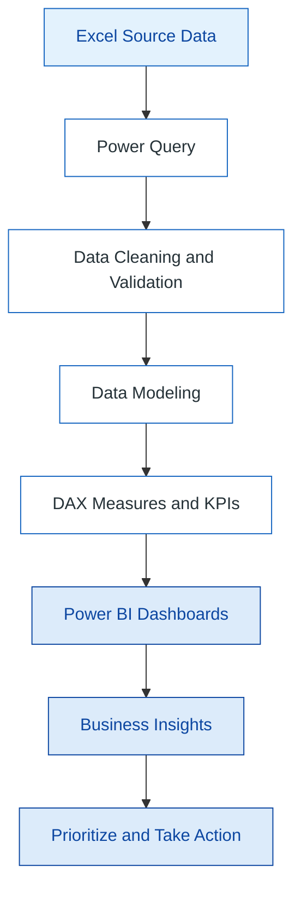
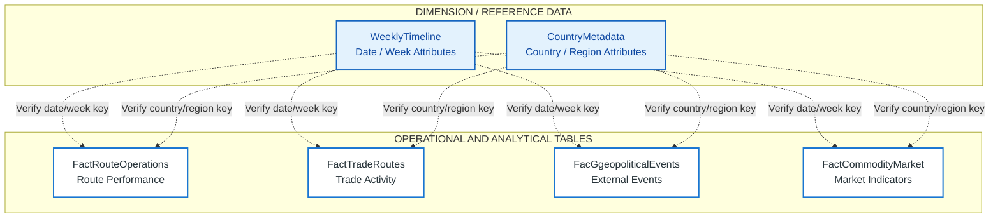
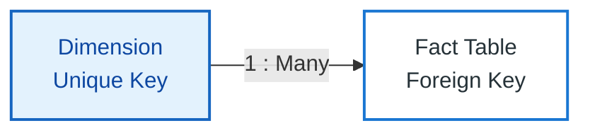

# 🚢 Supply Chain Control Tower | Excel · Power Query · Power BI

<div align="center">

<a href="https://github.com/karthymani58/Supply-chain-control-tower">
  
</a>


<br/>


**Transforming supply chain data into operational visibility, risk intelligence, and actionable business insights.**

[View Repository](https://github.com/karthymani58/Supply-chain-control-tower) · [View Excel Workbook](https://github.com/karthymani58/Supply-chain-control-tower/blob/main/Supply%20chain%20Working.xlsx)

</div>

---

## 📌 1. Executive Summary

The **Supply Chain Control Tower** is a business intelligence project focused on supply chain operations, transportation routes, freight costs, trade activity, commodity markets, and external disruption indicators.

The objective is to transform operational data into structured KPIs, interactive dashboards, and evidence-based recommendations that help management monitor performance and investigate potential risks.

The project follows five core business questions:

| Business Question | Analytical Objective |
|---|---|
| What is happening? | Monitor overall operational performance. |
| Where is it happening? | Identify routes, markets, and regions requiring attention. |
| Why is it happening? | Investigate potential causes of delays and disruptions. |
| What could happen next? | Monitor historical trends and available risk indicators. |
| What should management do? | Prioritize investigations and corrective actions. |

### 🎯 Business Objectives

- Analyze transportation and route performance.
- Examine freight costs and trade volumes.
- Investigate delayed operations and disruption indicators.
- Analyze market and country-level information.
- Build a structured Power BI data model.
- Develop DAX measures and interactive dashboards.
- Convert validated analytical findings into management actions.

## 🛠️ 2. Technology Stack

| Technology | Purpose |
|---|---|
| Microsoft Excel | Source data inspection and validation |
| Power Query | Data cleaning and transformation |
| Power BI Desktop | Interactive dashboard development |
| DAX | KPI calculations and business logic |
| Star Schema | Analytical data modeling approach |
| GitHub | Documentation and portfolio presentation |

---

## 📊 3. Dataset Overview

The existing project documentation reports the following figures. Validate them against the source workbook before presenting them as independently verified results.

| Metric | Reported Value |
|---|---:|
| Operational route runs | 30,048 |
| International trade corridors | 50 |
| Geopolitical/operational disruption events | 10,003 |
| Operational weeks | 626 |
| Average shipping delay | 6.38 days |
| Total freight cost | $122,062,713.71 |
| Total trade volume | 569,367,812.73 tons |
| Delayed records | 19,219 |
| Disrupted records | 960 |
| Duplicate records | 0 reported |
| Missing keys | 0 reported |

> These are previously documented project figures, not the result of a new audit. Confirm the metric definitions, currency, units, row grain, and data-quality rules before using them in business decisions.

### Source Workbook Tables

The workbook documentation lists these sheets:

- `Summary`
- `FactRouteOperations`
- `FactTradeRoutes`
- `FacGgeopoliticalEvents`
- `WeeklyTimeline`
- `CountryMetadata`
- `FactCommodityMarket`

Use the exact table names in the workbook and Power BI model. In particular, verify the spelling of `FacGgeopoliticalEvents` before renaming or referencing it.

---

## ⚙️ 4. End-to-End Project Workflow

<div align="center">


</div>



### Data Preparation

- Validate column names and data types.
- Investigate null values, errors, and duplicates.
- Standardize dates, categories, and identifiers.
- Validate dimension keys and relationships.
- Reconcile transformed totals with source totals.

---

## 🏗️ 5. Data Modeling — Conceptual Supply Chain Model

A well-designed data model separates measurable operational events from descriptive information. This supports consistent filtering, reusable DAX measures, and easier report maintenance.

**Important:** The diagram below is a conceptual model using your documented table names. The exact primary keys, foreign keys, and relationships must be confirmed against the actual workbook and PBIX model before this is described as the implemented schema.

### 📐 Visual Data Model



<sub>The dashed connections indicate candidate relationships to investigate, not confirmed joins. Do not create relationships unless compatible keys exist and the dimension side is unique.</sub>

### Why Use a Star Schema?

- Dimensions provide descriptive context for filtering and grouping.
- Fact tables contain measurable business events or observations.
- One-to-many relationships help filter facts through dimensions.
- Consistent dimensions can support comparisons across compatible fact tables.
- A dedicated date dimension supports reliable time-based analysis.

### Recommended Relationship Pattern



For example, a valid relationship might be:

```text
CountryMetadata[CountryKey]  1 ───── *  FactRouteOperations[CountryKey]
```

This is only an example. Use it only if both columns exist, the country dimension key is unique, and the values match.

### Data Model Validation Checklist

- [ ] Define the grain of every fact table.
- [ ] Identify candidate primary keys and foreign keys.
- [ ] Check dimension key uniqueness.
- [ ] Check for unmatched fact-table keys.
- [ ] Prefer one-to-many relationships where appropriate.
- [ ] Avoid unnecessary many-to-many relationships.
- [ ] Avoid direct fact-to-fact relationships unless specifically justified.
- [ ] Confirm date/week relationships.
- [ ] Validate relationship filter directions.
- [ ] Reconcile report totals after modeling.

### Suggested Modeling Improvements

Where the source data supports them, consider creating:

- `DimDate` — a proper calendar table.
- `DimRoute` — unique route information.
- `DimCountry` — standardized country and region attributes.
- `DimMarket` — standardized market attributes.

Do not create these as disconnected or duplicated dimensions without a clear modeling purpose. Verify whether `CountryMetadata` or `WeeklyTimeline` already provides the required attributes.

---

## 📈 6. Five Dashboard Pages

The following is the intended analytical structure. Keep the descriptions aligned with the pages actually implemented in the Power BI report.

### Page 1 — Executive Control Tower

**Question: What is happening?**

Recommended KPIs:

- Total operational records
- Total freight cost
- Total trade volume
- Average shipping delay
- Delayed records
- Disruption events

Recommended visuals:

- KPI cards
- Operational trend over time
- Freight cost by region or market
- Route performance comparison
- Delay and disruption overview

**Management objective:** Identify exceptions and understand overall operating performance.

### Page 2 — Route Performance & Operations

**Question: Where is it happening?**

Recommended visuals:

- Route-level performance matrix
- Route activity comparison
- Delay analysis by route
- Freight cost by route
- Origin and destination analysis
- Active and inactive route counts, if valid status fields exist

**Management objective:** Prioritize routes for operational investigation.

### Page 3 — Freight & Commodity Market Intelligence

**Question: How do freight and market conditions vary?**

Recommended visuals:

- Freight cost by market
- Trade volume by region or commodity
- Weekly or monthly trends
- Market comparisons
- Cost and volume analysis

**Management objective:** Understand changes in trade activity and freight expenditure.

### Page 4 — Geopolitical Risk & External Events

**Question: Where might operations be exposed to disruption?**

Recommended visuals:

- External events over time
- Events by country or region
- Risk category analysis
- Route exposure, where a valid route-to-event mapping exists
- Operational performance compared with external indicators

**Management objective:** Investigate potential exposure and support contingency planning.

> Correlation between external events and operational delays does not by itself prove causation.

### Page 5 — Sustainability & Supply Chain Resilience

**Question: What should management improve?**

Recommended visuals:

- Available sustainability indicators
- Route or market concentration
- Resilience indicators
- Disruption exposure trends
- Prioritized exceptions and follow-up actions

**Management objective:** Identify opportunities to strengthen resilience using evidence available in the dataset.

> Do not report carbon emissions or other sustainability KPIs unless the source data supports the required calculations.

---

## 🧮 7. DAX Measures — Starter Templates

The measures below are templates. Replace table and column names with those in the actual Power BI model and validate the business definitions.

### Total Operational Records

```dax
Total Operational Records =
COUNTROWS ( FactRouteOperations )
```

Use a distinct business identifier instead if one operational event occupies multiple rows.

### Total Freight Cost

```dax
Total Freight Cost =
SUM ( FactRouteOperations[FreightCost] )
```

Replace `FreightCost` with the actual freight-cost column.

### Total Trade Volume

```dax
Total Trade Volume =
SUM ( FactTradeRoutes[TradeVolume] )
```

Confirm the source column and unit of measurement.

### Average Shipping Delay

```dax
Average Shipping Delay (Days) =
AVERAGE ( FactRouteOperations[ShippingDelayDays] )
```

Use only if a validated numeric delay column exists.

### Delayed Records

```dax
Delayed Records =
CALCULATE (
    COUNTROWS ( FactRouteOperations ),
    FactRouteOperations[DeliveryStatus] = "Delayed"
)
```

Adapt the status value and row-counting logic to the actual dataset.

### Delay Percentage

```dax
Delay % =
DIVIDE (
    [Delayed Records],
    [Total Operational Records],
    0
)
```

Format the measure as a percentage. The numerator and denominator must use a consistent grain.

### Total External Event Records

```dax
External Event Records =
COUNTROWS ( FacGgeopoliticalEvents )
```

This counts rows, not necessarily unique events. If an event identifier exists, consider `DISTINCTCOUNT`.

### Operational Records — Weekly Trend

```dax
Operational Records =
COUNTROWS ( FactRouteOperations )
```

Use a validated date/week field on the visual axis and confirm that the date relationship filters the fact table correctly.

### DAX Best Practices

- Use measures for filter-responsive calculations.
- Use `DIVIDE()` for ratios.
- Use `VAR` and `RETURN` for complex calculations.
- Validate filter context and totals.
- Use consistent units and number formats.
- Reconcile key KPIs against source data.

---

## 🔍 8. Business Insight Framework

| Business Question | Analysis | Possible Action |
|---|---|---|
| What is happening? | Review operational KPIs and trends. | Monitor exceptions against targets. |
| Where is it happening? | Compare routes, markets, and regions. | Prioritize the highest-impact areas. |
| Why is it happening? | Investigate delays and supporting operational evidence. | Validate root causes before changing processes. |
| What could happen next? | Monitor historical trends and risk indicators. | Prepare contingency plans. |
| What should management do? | Rank issues by impact and urgency. | Assign actions, owners, and review dates. |

### How to Document a Finding

For each actual insight, record:

1. **Observation:** What does the report show?
2. **Evidence:** Which KPI, comparison, or trend supports it?
3. **Business impact:** Why does it matter?
4. **Recommendation:** What action should be considered?
5. **Follow-up:** Who owns the action, and when will it be reviewed?

The dashboard should communicate validated findings rather than assume that every unusual pattern has a single proven cause.

---

## 🧹 9. Data Quality & Power Query

### Data Preparation Steps

1. Inspect source tables and column names.
2. Correct date, numeric, and text data types.
3. Standardize category values and identifiers.
4. Investigate nulls, errors, and missing keys.
5. Check duplicates using the defined business grain.
6. Validate costs, quantities, and dates.
7. Check foreign-key coverage.
8. Reconcile source and transformed totals.
9. Document assumptions and exclusions.
10. Refresh the report and retest key measures.

### Quality Checklist

- [ ] Source row counts recorded.
- [ ] Data types validated.
- [ ] Missing values investigated.
- [ ] Duplicate records investigated.
- [ ] Dimension keys checked for uniqueness.
- [ ] Fact-to-dimension relationships validated.
- [ ] KPI totals reconciled.
- [ ] Refresh tested successfully.

---

## 🎨 10. Dashboard Design Theme

The recommended style is a clean white-and-blue executive dashboard.

| Element | Color |
|---|---|
| Page background | `#FFFFFF` |
| Primary blue | `#1565C0` |
| Dark blue | `#0D47A1` |
| Light blue | `#E3F2FD` |
| Main text | `#263238` |
| Secondary text | `#607D8B` |

### Design Principles

- Use consistent page headers.
- Keep KPI cards simple and readable.
- Apply consistent number formats.
- Use slicers for relevant dimensions.
- Use conditional formatting with documented thresholds.
- Avoid unnecessary visual clutter.
- Make chart titles communicate the business question.

---

## 🚀 11. How to Access the Project

### Repository

[Open Supply Chain Control Tower on GitHub](https://github.com/karthymani58/Supply-chain-control-tower)

### Clone the Repository

```bash
git clone https://github.com/karthymani58/Supply-chain-control-tower.git
cd Supply-chain-control-tower
```

### Open the Source Workbook

Open `Supply chain Working.xlsx` in Excel and verify the actual source sheets and columns.

### Open Power BI

Open the `.pbix` file if it is available in the repository or in your local project folder.

Then:

1. Check Power Query source paths.
2. Review the model relationships.
3. Validate DAX measures.
4. Refresh the report.
5. Compare important results against the source data.

**Note:** Add links to the PBIX and dashboard screenshots only after the corresponding files have been committed to GitHub.

---

## 📂 12. Suggested Repository Structure

```text
Supply-chain-control-tower/
│
├── README.md
├── Supply chain Working.xlsx
├── archive.zip
│
├── PowerBI/
│   └── Supply_Chain_Control_Tower.pbix
│
├── Screenshots/
│   ├── executive_control_tower.png
│   ├── route_performance.png
│   ├── market_intelligence.png
│   ├── geopolitical_risk.png
│   └── resilience_sustainability.png
│
└── Documentation/
    ├── data_model.md
    ├── dax_measures.md
    └── data_quality_checks.md
```

This is a suggested structure. Create the folders only when the relevant files are ready.

---

## 💼 13. Skills Demonstrated

- Excel data inspection and validation
- Power Query data transformation
- Data modeling and star-schema concepts
- DAX measures and KPI development
- Power BI dashboards
- Route and operational performance analysis
- Freight and trade analytics
- External risk indicator analysis
- Data quality and reconciliation
- Business insight communication
- GitHub portfolio documentation

---

## 🔮 14. Future Enhancements

- Automated data refresh and quality monitoring.
- Validated shipment tracking integration.
- Predictive delay-risk analysis.
- Evidence-based root-cause analysis.
- Role-specific reporting for operations and leadership.
- Sustainability measures where suitable data exists.
- Exception thresholds, ownership, and action tracking.
- Performance monitoring after corrective actions.

---

## 👨‍💻 15. About the Project

The Supply Chain Control Tower demonstrates how data preparation, analytical modeling, KPI development, and visualization can support supply chain decision-making.

**Focus areas:** Supply Chain Analytics · Data Analytics · Business Intelligence · Power BI · DAX · Data Modeling

<div align="center">

### ⭐ If you find this project useful, consider starring the repository!

**Excel · Power Query · Power BI · DAX**

*Turning supply chain data into actionable decisions.*

[Back to Top](#-supply-chain-control-tower--excel--power-bi)

</div>

---

## Author

<div align="center">

### Karthik M

**Supply Chain Analytics | Data Governance | Business Intelligence**

[](https://www.linkedin.com/in/karthik--m--online/)
[](https://github.com/karthymani58)
[](mailto:karthymani58@gmail.com)

</div>

---

<div align="center">

*Designed for professional supply chain analytics and business intelligence reporting.*


</div>
